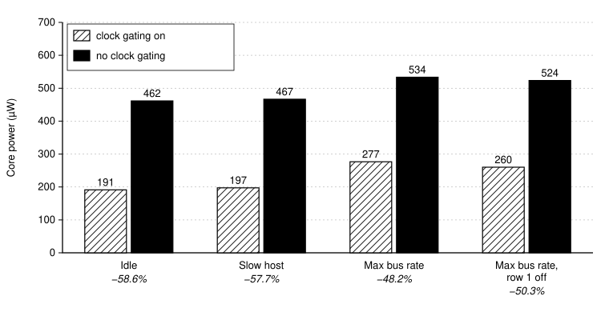

   

# One-Tile int4 NPU (2x2 MAC Array) for Tiny Tapeout

A 2×2 int4 multiply-accumulate array with 16-bit accumulators, one clock gate per row and a full scan chain
(96 flops), driven by a host microcontroller over a byte-wide register bus on the pins. Top module
`tt_um_akln0401_npu`, 50 MHz.

- Datasheet (how it works, register map, protocol, how to test, scan chain map): [docs/info.md](docs/info.md)
- Project page with layout images and signoff numbers: `docs/overview.html` (self-contained, open locally)

## Layout

| Path | Contents |
|---|---|
| `info.yaml` | TT metadata: top module, tile size, clock, sources, pinout |
| `src/` | `project.v` (top, pin register bus, scan, reset sync), `npu_array.v`, `npu_pe.v`, `dft/clk_gate.v` (ICG wrapper); `config.json` + `base.sdc` (flow config) |
| `test/` | cocotb tests through the pins (RTL and gate level); `scan_map.py` prints the scan chain map |
| `test/extra/` | archived harnesses: RTL-vs-netlist co-simulation and SDF gate-level sims |
| `tools/` | local helpers: container image, sims, hardening, precheck, layout renders |
| `audit/` | pre-tapeout audit: reports, signoff checklist, power/clock-gating analysis, `run_pre_tapeout_audit.sh` |

## Running the tests

```bash
cd test
make                 # RTL (cocotb 2.1 + Icarus, see requirements.txt)
make GATES=yes       # gate level, needs gate_level_netlist.v and PDK_ROOT
```

## Clock gating: power saved



Each row of MAC units has its own integrated clock gate (`sky130_fd_sc_hd__dlclkp_1`), so a row's clock runs only
on the cycle after a step or clear. To measure what that buys, the post-PnR netlist was simulated running real
workloads through its pins, and the switching activity went into OpenSTA with the routed parasitics. Every workload
ran twice with identical bus traffic: normally, and with `test_mode` high, which forces both row clocks on (the
design without clock gating). **Clock gating saves 45–59% of core power** at every corner, 0.25–0.27 mW at the
typical corner, and almost all of it comes from the clock tree and the clock pins of the 64 accumulator flops.

Method, all corners and limits: [`docs/overview.html`](docs/overview.html) §9 and
[`audit/11_power_clock_gating.md`](audit/11_power_clock_gating.md); `audit/power/run_power.sh` reproduces the numbers.
These are pre-silicon estimates for this tile's core; on the bench the same comparison is `uio[4]` low vs. high.

## Pre-submission signoff (LibreLane 3.0.14, same flow as the `gds` action)

DRC 0, LVS 0, antenna 0, utilization 84.4%, setup +5.70 ns / hold +0.162 ns across 12 corners (−40…100 °C),
TT precheck 15/15, RTL and GL tests 17/17 (including all 256 int4 operand pairs on every MAC unit), SDF GL tests at
4 corners, RTL-vs-netlist random co-simulation with 0 mismatches, a formal proof of the MAC unit and a formal
equivalence check of RTL against the post-PnR netlist. Full report: [`audit/`](audit/00_executive_summary.md).
